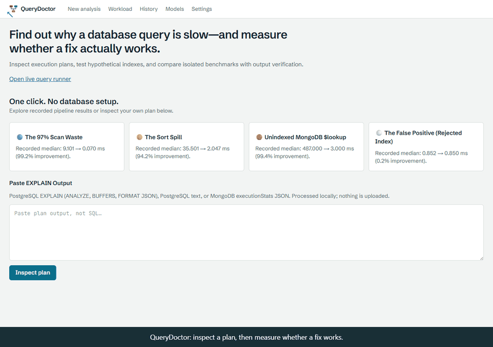
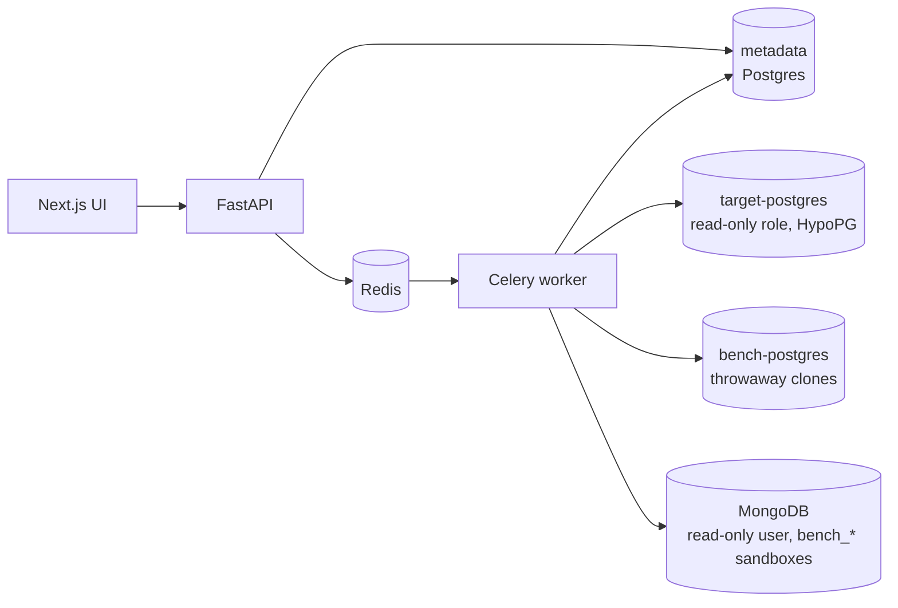

# QueryDoctor: Find out why a database query is slow—and measure whether a fix actually works.

Inspect execution plans, validate hypothetical indexes in memory, and benchmark candidates in isolated sandboxes with cryptographic output verification.



| Example | Before | After | Evidence |
|---|---:|---:|---|
| 250k-row selective scan | 9.101 ms | 0.070 ms | 7 runs, row count + SHA-256 match |
| External sort spill | 35.501 ms | 2.047 ms | 7 runs, row count + SHA-256 match |
| MongoDB foreign lookup | 487.000 ms | 3.000 ms | 7 runs, row count + SHA-256 match |
| Rejected index (stale statistics) | 0.852 ms | 0.850 ms | Planner favored it; benchmark rejected it |

**[Live Zero-Setup Showcase](https://query-doctor-omega.vercel.app/)** · Four recorded cases, paste-an-EXPLAIN, and a recorded [Ranked Fix Queue](https://query-doctor-omega.vercel.app/workload). No database setup. · [CI regression gate](docs/ci-regression-gate.md)
The 60-second GIF is recorded from the app.

## Try it without Docker

```bash
cd apps/web
npm ci
npm run dev
```

Open http://localhost:3000. Click any of four showcase cards or paste PostgreSQL EXPLAIN JSON/text or
MongoDB executionStats JSON. Parsing runs locally in your browser, with no API calls or database setup.
Pasted suggestions remain **Unverified**. Showcase cards replay complete recorded pipeline captures, including
plans, cost comparisons, run distributions and output checks. Numbers vary by hardware. Regenerate with
[scripts/capture_showcase.py](scripts/capture_showcase.py) against disposable instances; raw evidence is downloadable
from each card. Both engines record row/document counts and SHA-256 output verification. MongoDB 7 uses a fixed
internal server function; only digests leave the database. User-supplied JavaScript stays prohibited.

## Full local demo: one command

```bash
bash run_demo.sh                    # QD_SCALE=demo: 100k orders
QD_SCALE=full bash run_demo.sh      # 1M orders in separate retained -full volumes
```

Requires Docker Desktop and curl (Windows: Git Bash or WSL). The script builds the stack, seeds both engines,
keeps demo/full datasets in separate volumes, waits for API/web readiness, then prints `✅ QueryDoctor Ready at http://localhost:3000` and the golden path.
Warm starts target a quick demo; cold image builds and full-scale seeding may take longer than two minutes.

1. Click **The 97% Scan Waste**.
2. Click the red **Seq Scan** operator in its plan graph.
3. Click **Full recorded evidence** to inspect timing distributions and SHA-256 verification.

For a fresh measurement, open **Live query runner**, pick a sample, choose **Execute with analysis**, then approve
an index benchmark. Workload → **Analyze top 5 & approve isolated
benchmarks** runs the busiest replayable PostgreSQL sample queries and consolidates qualifying indexes into
a ranked fix queue. Customer-source automatic benchmarking remains disabled; use an explicitly seeded CI database.
Daily savings require a known capture window and estimate execution time, not CPU time.

## Engineering deep dive

**Verification ladder:** Suggested → Planner-Validated (HypoPG) → Benchmark-Validated (isolated clones and matching
output). HypoPG changes only planner estimates. Benchmark validation requires at least 10% improvement, indexed p95
below baseline median, matching output, and actual index use. MongoDB skips HypoPG because it has no hypothetical indexes.

**CI/CD gate:** baseline schema plus deterministic seeds are cloned, candidate migrations applied, and workload runs
alternated to reduce drift bias. Row-count/digest mismatches fail regardless of latency; noisy or missing evidence
cannot pass. Reports include medians, variability, planner comparisons and migration snippets. The supplied workflow
compares exact PR base/head Git revisions using [.querydoctor/ci.json](.querydoctor/ci.json), supports offline native
migration exporters, and refuses a pass for changed database files outside configured coverage. The checked-in profile
covers the sample schema; [configure an application profile](docs/ci-regression-gate.md) for another schema/workload.

[See the bot catch a deliberate index-drop regression on a real PR](https://github.com/mrhpsingh01/query_doctor/pull/1#issuecomment-6210487368)
(0.108 ms → 10.210 ms on the latest verification run, identical output, measured index fix). This draft demonstrates a correctly failing gate and must not be merged.
The [implementation audit](docs/implementation-audit.md) records test evidence and application-specific configuration limits.

**Planner vs. ML ranking:** on the repository's held-out query shapes, the planner heuristic ties the learned models
at NDCG@3 ≈ 0.986. The best learned gain is +0.001 (90% interval −0.002 to +0.004), insufficient to replace the planner.
This is evidence of no demonstrated ML advantage on this dataset, not a universal claim that PostgreSQL always wins.
LightGBM predictions remain advisory. Optional LLM explanations are grounded in recorded metrics, checked against
facts, and fall back to deterministic templates. See [the evaluation](docs/ml-evaluation.md).

## The journey

1. **Pick or paste a slow query.** Eight curated ones ship with the sample shop. Nothing runs against the database
   until you submit.
2. **Read the plan.** Operators are laid out with the result on top. Each carries a thin bar showing how much of the
   query's time that step spent itself, so the bottleneck is visible before you read a number.
3. **See the evidence.** Every finding cites the measurements that triggered it and says what might help.
4. **Get index ideas, labelled by how well they are backed.**

   | Label | Meaning |
   |---|---|
   | Suggested | Derived from the query's shape. Not tested. |
   | Planner-validated | PostgreSQL's planner picks the index in a what-if test (HypoPG). Not measured. |
   | Benchmark-validated | Measured faster, with identical output, in an isolated copy of the database. |

5. **Approve a benchmark** (an explicit confirmation is required), watch it run, and compare medians, p95, index size
   and build time.
6. **Export the report** as Markdown or standalone HTML.


## MongoDB

Choose **MongoDB** on the New analysis page: the editor switches to JSON, and eight curated slow queries over the same
shop (orders, customers, events with embedded items and payments) load as samples. A query is one `find` or `aggregate`
as JSON, with `{"$param": 1}` marking values:

```json
{"find": "orders", "filter": {"customer_id": {"$param": 1}}}
```

* **Validated before anything runs.** Only reads: stages are allowlisted, `$where` / `$function` / `$accumulator` /
  `$out` / `$merge` are refused at any depth (including inside `$lookup` sub-pipelines), and depth, size, limit and
  regex length are capped. Commands carry `maxTimeMS` and run as a read-only user.
* **Plan evidence is labeled by mode.** A planner-only MongoDB explain shows the chosen operators. When the user opts
  into execution statistics, plan nodes can show *documents examined, documents returned* and amplification ("500k
  examined for 20 returned: 25k× per result"). `explain()` bypasses the plan cache, so these figures are not live-workload
  latency measurements.
* **Ten MongoDB rules** ([catalog](docs/rule-catalog.md#mongodb-rules)): collection scans, scan and key amplification,
  blocking sorts, compound-index field order, unbounded `$group`, `$lookup` into unindexed fields, unselective and
  redundant indexes, and a `$match` that could run earlier.
* **Index ideas follow the ESR rule** (equality, then sort, then range) and are shown as the command you would run:
  `db.orders.createIndex({"customer_id": 1})`. MongoDB has no hypothetical indexes, so an idea stays *Suggested* until a
  benchmark measures it.
* **Benchmarks run in a throwaway database** (`bench_<12 hex>`) on the same server: the touched collections and their
  existing indexes are copied with `$out`, the real index is built there, and the query is timed before and after. The
  SHA-256 row digests are computed inside the database; the worker folds sorted digests and a count, so no result document leaves it.
  The sandbox is always dropped, and at most two run at once. The sample data is only ever read.
* **Workload** reads the profiler (`system.profile`, level 2 in the sample) and ranks query shapes the same way. The
  profiler records whole milliseconds, so a sub-millisecond query shows 0 ms and cannot top the ranking however often
  it runs; that is a limit of the profiler, not hidden.


## Which query should I fix first? (Workload)

A single slow query is only half the question. The **Workload** page imports the database's own statistics
(`pg_stat_statements` for PostgreSQL, the profiler for MongoDB; a selector switches between them), merges statements that
are the same query shape, and ranks them by **total time** (mean × calls), because a 6 ms query called 1,500 times costs
more than a 600 ms query called once.

* Seven panels: highest total time, slowest (estimated) p95, most frequent, highest I/O, most unstable, largest
  regression, and queries with no benchmark evidence yet.
* `pg_stat_statements` keeps no percentiles, so the p95 shown is **estimated** (mean + 1.645 standard deviations) and
  labelled that way. A measured p95 appears only for queries you benchmark.
* Import twice and the page compares the snapshots: counters are cumulative, so it works out the mean over the calls
  made *between* them and flags queries that got 1.5× slower or more.
* **History** groups every analysis by query shape: how often it was analysed, measured latency, plan changes, and the
  best evidence level reached.
* The sample database comes with demo traffic (a baseline run at first start; **Generate demo traffic** and
  **Simulate a regression** on the page).


## Does a model help choose the index? (honest answer: not yet)

Index ideas carry a separate **Prediction** block (expected speedup, probability of helping, index size, regression
risk, and the top three reasons) from a LightGBM model trained on 3,670 measured candidates. It is advice, never
evidence, and it does not change the evidence badge. On held-out query shapes the model did **not** order suggestions
better than the planner score, so the planner score keeps ordering them; see [docs/ml-evaluation.md](docs/ml-evaluation.md)
for the numbers and limits. The **Models** page shows the comparison, calibration and live monitoring. Rebuild the model
with `python -m querydoctor.lab.dataset_gen` (measures candidates; resumable) and `python -m querydoctor.ranking.train_cli`.

## Explanations, your own databases, privacy

* **Explain** (on every analysis) writes a plain-language explanation of the plan, findings, trade-offs, next experiment
  or a pull-request comment. Each sentence cites numbered facts shown beside it, so every number is traceable. A
  deterministic template always works; with `QD_OLLAMA_MODEL` set (a local Ollama model) a draft is requested and
  **validated**: invented numbers, uncited sentences or SQL are removed or rejected and the template is used instead.
  To use a local model, install [Ollama](https://ollama.com), pull a model (for example `ollama pull llama3.1`), and start
  the stack with `QD_OLLAMA_MODEL=llama3.1` (the API reaches the host's Ollama at `http://host.docker.internal:11434`;
  override with `QD_OLLAMA_URL`). With no model set, or if Ollama is down or slow, the template answers and says why.
* **Your own PostgreSQL and MongoDB sources** can be registered once an operator sets `QD_ALLOW_CUSTOM_CONNECTIONS=true`
  (off by default). Deployed customer mode requires bearer tokens, project membership, and a Fernet key. Hosts are checked
  against blocked address ranges at registration and use; passwords are encrypted and never shown. Customer benchmarks
  remain blocked until isolated benchmark targets are implemented. See [docs/security.md](docs/security.md) and the
  [customer release specification](docs/customer-release-spec.md).
* **Privacy:** the Settings page lists what is stored, queries and parameters never reach the logs, and an analysis or
  connection can be deleted at any time.

## How it works



Each database engine is an **adapter** behind one interface (validate, collect schema, explain, normalize the plan,
diagnose, generate candidates, test, benchmark, collect workload), so the pipeline, the API and the UI are the same for
both.

An analysis moves through increasingly expensive, increasingly trustworthy stages:

1. **Validate** the SQL: a single `SELECT`, no DDL/DML, no dangerous functions.
2. **Plan** with `EXPLAIN (FORMAT JSON)`, or `EXPLAIN ANALYZE` when you chose to execute.
3. **Diagnose** with ten deterministic rules ([catalog](docs/rule-catalog.md)).
4. **Generate** index candidates and prune redundant ones.
5. **Test** each with HypoPG (planner only, nothing created).
6. **Benchmark** the ones you approve in a clone of the database.

See [docs/architecture.md](docs/architecture.md) for the details and [docs/security.md](docs/security.md) for the
threat model.

### Benchmark methodology

For each approved candidate, on a dedicated instance:

1. Clone the sample database (`CREATE DATABASE … TEMPLATE`), recording the PostgreSQL version, relevant settings and a
   dataset snapshot id.
2. Warm up, then time the original query in **5–10 measured runs** (default 7).
3. Create the **real** index, time the build, `ANALYZE`, and note its size.
4. Warm up and time the same query with the same parameters.
5. Compare **medians and 95th percentiles**, the coefficient of variation, and a server-side checksum of the query
   output, so a faster but different answer is never reported as an improvement.
6. Drop the clone, always (a janitor also removes clones abandoned by a crashed worker).

Timings are `EXPLAIN (ANALYZE)` execution times; the instrumentation overhead is equal on both sides. Warnings are
attached when variance is high, runs are too few, the first run dominates (cache warming), or the output differs. A
regression is shown as "slower", never hidden, and only a faster run with matching output earns *Benchmark-validated*.

## The curated slow queries

| Query | What goes wrong | What QueryDoctor finds |
|---|---|---|
| Recent orders for one customer | no index on `customer_id` | large filtered sequential scan → `(customer_id, created_at)` |
| Orders by status in a date window | skewed status + narrow range | sequential scan → `(status, created_at)` |
| Orders joined to payments | unindexed join key | scan → `payments(order_id)` |
| Large result sorted for no reason | sort spills to disk | sort spill |
| `lower(email) = $1` | function defeats an existing index | expression index on `lower(email)` |
| `SELECT *` across four tables | 21 columns returned | wide result |
| Correlated subquery | inner scan repeated per row | repeated loop → `orders(customer_id)` |
| Country + currency filters | correlated columns | 20× cardinality misestimate |

The golden tests assert each of these against real PostgreSQL.

### The MongoDB catalog

| Query | What goes wrong | What QueryDoctor finds |
|---|---|---|
| Orders of one customer | no index on `orders.customer_id` | collection scan → `{customer_id: 1}` |
| A rare status in a narrow date window | the status index narrows, every match is fetched | scan amplification → `{status: 1, created_at: 1}` |
| Sorting a large result in memory | 300k events sorted to return 20 | blocking sort → `{event_type: 1, payload: 1}` |
| An index with the range field first | `created_at` precedes `customer_id` | key amplification and field order → `{customer_id: 1, created_at: 1}` |
| `$lookup` into an unindexed field | every customer scans all orders | large lookup → `{customer_id: 1}` |
| Filtering after grouping | all orders grouped, one group kept | stage order |
| An unbounded `$group` | every event read and grouped | unbounded aggregation |
| An index that matches most documents | 60% of orders are `completed` | unselective index |

The golden tests assert each of these against real MongoDB, and five of them are benchmarked and validated.

## Development

```bash
python -m venv .venv && .venv/Scripts/activate        # use .venv/bin/activate on macOS/Linux
pip install -e "packages/querydoctor[dev]" -e "apps/api[dev]"
docker compose -f infrastructure/compose.yaml up -d --build   # the integration tests need the stack

python -m pytest                          # backend: unit + live-database integration + golden tests
python -m pytest -m chaos apps/api/tests/chaos   # failure injection against the running stack
cd apps/web && npm ci && npm test         # frontend unit tests (Vitest)
npm run e2e                               # every user journey, PostgreSQL and MongoDB, in Chrome (Playwright)
```

Integration tests skip themselves with a clear message when the Docker lab is not running.

| Layer | Tests |
|---|---|
| Plan parser, ten diagnosis rules, candidates, statistics, reports | pytest on committed plan fixtures (no database needed) |
| SQL safety, guarded sessions, HypoPG, sandbox, benchmark runner | pytest against the live lab |
| API: pipeline, SSE, benchmarks, adversarial input | pytest (in-process) and against the running stack |
| Golden tests | every catalog query diagnosed and its index validated on real PostgreSQL |
| Workload | statement merging, ranking, regression and plan-change detection (pure); import and ranking against the live lab, for both engines |
| MongoDB | validator (hostile specs), plan normalization on live-captured explain fixtures, rules, ESR candidates, sandbox, benchmark and golden tests against real MongoDB |
| Ranking model | features, grouped splits, metrics, calibration, the promotion guard (pure); a fresh-process model load |
| Explanations, network guard, privacy | claim validator, template, Ollama fallbacks; address classification and DNS pinning; log redaction |
| Failure injection (`-m chaos`) | lock contention, a restarted database, a killed worker, a hanging model |
| UI components and logic | Vitest + Testing Library |
| The user journey | Playwright |

## Layout

```
packages/querydoctor/   the engine: safety, plan_parser, diagnosis, candidates, benchmark, workload, db, lab,
                        adapters (postgres, mongodb), mongo, ranking, explain, netguard
apps/api/               FastAPI control plane + Celery worker + Alembic migrations
apps/web/               Next.js UI (Monaco, React Flow, Recharts)
infrastructure/         Docker images and compose.yaml
fixtures/               committed plan fixtures and the slow-query catalog
docs/                   architecture, security, rule catalog, design spec and implementation plan
```

## Scope of this release

PostgreSQL 16 `SELECT` queries and MongoDB 7 `find` / `aggregate` reads, one at a time, against the sample databases.
Custom PostgreSQL and standalone MongoDB source analysis is available behind an off-by-default flag. Bearer authentication
and project membership protect the customer API; the web UI still lacks a sign-in flow. Customer benchmark targets,
cross-workload proposal scoring, CI comparison, and sharded or replica-set MongoDB qualification remain planned work.
MongoDB roles cannot be scoped to database names, so the demo benchmark user may
create and drop any database on its server: use a dedicated MongoDB for benchmarks anywhere that matters
([docs/security.md](docs/security.md#mongodb)). The design is in [docs/superpowers/specs](docs/superpowers/specs) and the build
plans in [docs/superpowers/plans](docs/superpowers/plans).

The SQL editor (Monaco) loads from a CDN; without network access the page falls back to a plain text area.


To regenerate the 60-second demo after starting the web app:

```bash
node scripts/rehearse_demo.mjs
QD_DEMO_URL=http://localhost:3000 node scripts/record_demo.mjs
python scripts/render_demo_gif.py  # optional documentation tool: requires Pillow
```
