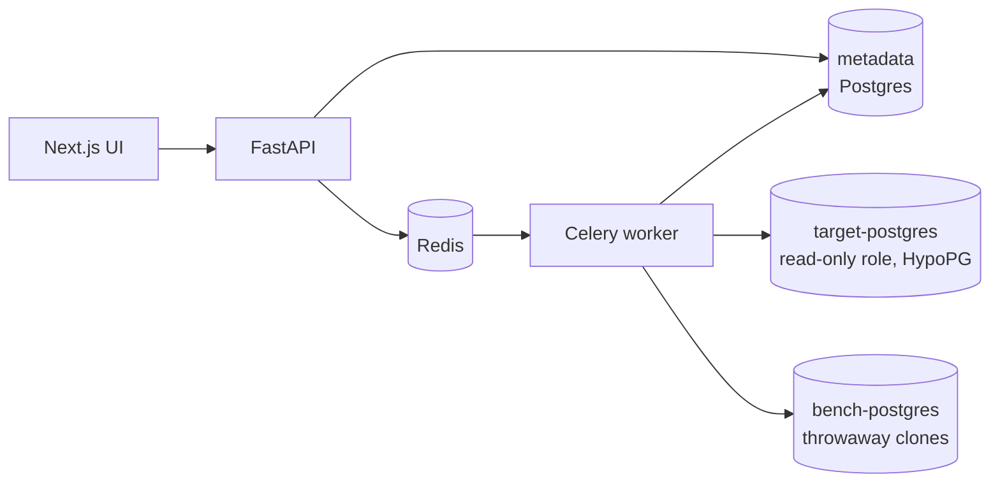

# QueryDoctor

**An evidence-based PostgreSQL performance investigator.** Give it a slow `SELECT`. It reads the execution plan,
finds the bottleneck, tests index ideas without creating them, benchmarks the promising ones in an isolated copy of the
database, and recommends only what the measurements support.

> The slow query took 8 ms because PostgreSQL scanned all 100,000 orders and threw away 97.2% of them. A composite
> index on `(customer_id, created_at)` turns the sequential scan into an index scan. Across 7 runs the median fell to
> 0.32 ms (95.8% faster), with identical output.

That sentence is generated from measurements, not from a language model guessing. There is no LLM in this release.


## Try it

You need Docker. From the repository root:

```bash
docker compose -f infrastructure/compose.yaml up -d --build
```

| What | Where |
|---|---|
| Web app | <http://localhost:3000> |
| API (OpenAPI docs at `/docs`) | <http://localhost:8010> |

The first start builds the images, creates three PostgreSQL 16 instances plus Redis, and loads a deterministic,
skewed e-commerce dataset (100k orders by default). Open the web app, pick **Recent orders for one customer**, choose
**Execute with analysis**, and follow the journey below.

Use the larger demo dataset (1M orders, 3M order items, 5M events) with `QD_SCALE=full`, and set `QD_API_PORT` /
`QD_WEB_PORT` if a default port is taken on your machine.

## The journey

1. **Pick or paste a slow query.** Eight curated ones ship with the sample shop. Nothing runs against the database
   until you submit.
2. **Read the plan.** Operators are laid out with the result on top. Each carries a thin bar showing how much of the
   query's time that step spent itself, so the bottleneck is visible before you read a number.
3. **See the evidence.** Every finding cites the measurements that triggered it and says what might help.
4. **Get index ideas, labelled by how well they are backed.**

   | Label | Meaning |
   |---|---|
   | Suggested | Derived from the query's shape. Not tested. |
   | Planner-validated | PostgreSQL's planner picks the index in a what-if test (HypoPG). Not measured. |
   | Benchmark-validated | Measured faster, with identical output, in an isolated copy of the database. |

5. **Approve a benchmark** (an explicit confirmation is required), watch it run, and compare medians, p95, index size
   and build time.
6. **Export the report** as Markdown or standalone HTML.


## Which query should I fix first? (Workload)

A single slow query is only half the question. The **Workload** page imports the database's own statistics
(`pg_stat_statements`), merges statements that are the same query shape, and ranks them by **total time**
(mean × calls), because a 6 ms query called 1,500 times costs more than a 600 ms query called once.

* Seven panels: highest total time, slowest (estimated) p95, most frequent, highest I/O, most unstable, largest
  regression, and queries with no benchmark evidence yet.
* `pg_stat_statements` keeps no percentiles, so the p95 shown is **estimated** (mean + 1.645 standard deviations) and
  labelled that way. A measured p95 appears only for queries you benchmark.
* Import twice and the page compares the snapshots: counters are cumulative, so it works out the mean over the calls
  made *between* them and flags queries that got 1.5× slower or more.
* **History** groups every analysis by query shape: how often it was analysed, measured latency, plan changes, and the
  best evidence level reached.
* The sample database comes with demo traffic (a baseline run at first start; **Generate demo traffic** and
  **Simulate a regression** on the page).


## Does a model help choose the index? (honest answer: not yet)

Index ideas carry a separate **Prediction** block (expected speedup, probability of helping, index size, regression
risk, and the top three reasons) from a LightGBM model trained on 3,670 measured candidates. It is advice, never
evidence, and it does not change the evidence badge. On held-out query shapes the model did **not** order suggestions
better than the planner score, so the planner score keeps ordering them; see [docs/ml-evaluation.md](docs/ml-evaluation.md)
for the numbers and limits. The **Models** page shows the comparison, calibration and live monitoring. Rebuild the model
with `python -m querydoctor.lab.dataset_gen` (measures candidates; resumable) and `python -m querydoctor.ranking.train_cli`.

## How it works



An analysis moves through increasingly expensive, increasingly trustworthy stages:

1. **Validate** the SQL: a single `SELECT`, no DDL/DML, no dangerous functions.
2. **Plan** with `EXPLAIN (FORMAT JSON)`, or `EXPLAIN ANALYZE` when you chose to execute.
3. **Diagnose** with ten deterministic rules ([catalog](docs/rule-catalog.md)).
4. **Generate** index candidates and prune redundant ones.
5. **Test** each with HypoPG (planner only, nothing created).
6. **Benchmark** the ones you approve in a clone of the database.

See [docs/architecture.md](docs/architecture.md) for the details and [docs/security.md](docs/security.md) for the
threat model.

### Benchmark methodology

For each approved candidate, on a dedicated instance:

1. Clone the sample database (`CREATE DATABASE … TEMPLATE`), recording the PostgreSQL version, relevant settings and a
   dataset snapshot id.
2. Warm up, then time the original query in **5–10 measured runs** (default 7).
3. Create the **real** index, time the build, `ANALYZE`, and note its size.
4. Warm up and time the same query with the same parameters.
5. Compare **medians and 95th percentiles**, the coefficient of variation, and a server-side checksum of the query
   output, so a faster but different answer is never reported as an improvement.
6. Drop the clone, always (a janitor also removes clones abandoned by a crashed worker).

Timings are `EXPLAIN (ANALYZE)` execution times; the instrumentation overhead is equal on both sides. Warnings are
attached when variance is high, runs are too few, the first run dominates (cache warming), or the output differs. A
regression is shown as "slower", never hidden, and only a faster run with matching output earns *Benchmark-validated*.

## The curated slow queries

| Query | What goes wrong | What QueryDoctor finds |
|---|---|---|
| Recent orders for one customer | no index on `customer_id` | large filtered sequential scan → `(customer_id, created_at)` |
| Orders by status in a date window | skewed status + narrow range | sequential scan → `(status, created_at)` |
| Orders joined to payments | unindexed join key | scan → `payments(order_id)` |
| Large result sorted for no reason | sort spills to disk | sort spill |
| `lower(email) = $1` | function defeats an existing index | expression index on `lower(email)` |
| `SELECT *` across four tables | 21 columns returned | wide result |
| Correlated subquery | inner scan repeated per row | repeated loop → `orders(customer_id)` |
| Country + currency filters | correlated columns | 20× cardinality misestimate |

The golden tests assert each of these against real PostgreSQL.

## Development

```bash
python -m venv .venv && .venv/Scripts/activate        # use .venv/bin/activate on macOS/Linux
pip install -e "packages/querydoctor[dev]" -e "apps/api[dev]"
docker compose -f infrastructure/compose.yaml up -d --build   # the integration tests need the stack

python -m pytest                          # backend: unit + live-database integration + golden tests
cd apps/web && npm ci && npm test         # frontend unit tests (Vitest)
npm run e2e                               # the full user journey in Chrome (Playwright)
```

Integration tests skip themselves with a clear message when the Docker lab is not running.

| Layer | Tests |
|---|---|
| Plan parser, ten diagnosis rules, candidates, statistics, reports | pytest on committed plan fixtures (no database needed) |
| SQL safety, guarded sessions, HypoPG, sandbox, benchmark runner | pytest against the live lab |
| API: pipeline, SSE, benchmarks, adversarial input | pytest (in-process) and against the running stack |
| Golden tests | every catalog query diagnosed and its index validated on real PostgreSQL |
| Workload | statement merging, ranking, regression and plan-change detection (pure); import and ranking against the live lab |
| UI components and logic | Vitest + Testing Library |
| The user journey | Playwright |

## Layout

```
packages/querydoctor/   the engine: safety, plan_parser, diagnosis, candidates, benchmark, workload, db, lab
apps/api/               FastAPI control plane + Celery worker + Alembic migrations
apps/web/               Next.js UI (Monaco, React Flow, Recharts)
infrastructure/         Docker images and compose.yaml
fixtures/               committed plan fixtures and the slow-query catalog
docs/                   architecture, security, rule catalog, design spec and implementation plan
```

## Scope of this release

PostgreSQL 16, `SELECT` queries, one at a time, against the sample database. Not included yet: your own database
connections, authentication, grounded
LLM explanations, and MongoDB support. The design for the first release is in
[docs/superpowers/specs](docs/superpowers/specs) and the build plan in [docs/superpowers/plans](docs/superpowers/plans).

The SQL editor (Monaco) loads from a CDN; without network access the page falls back to a plain text area.
